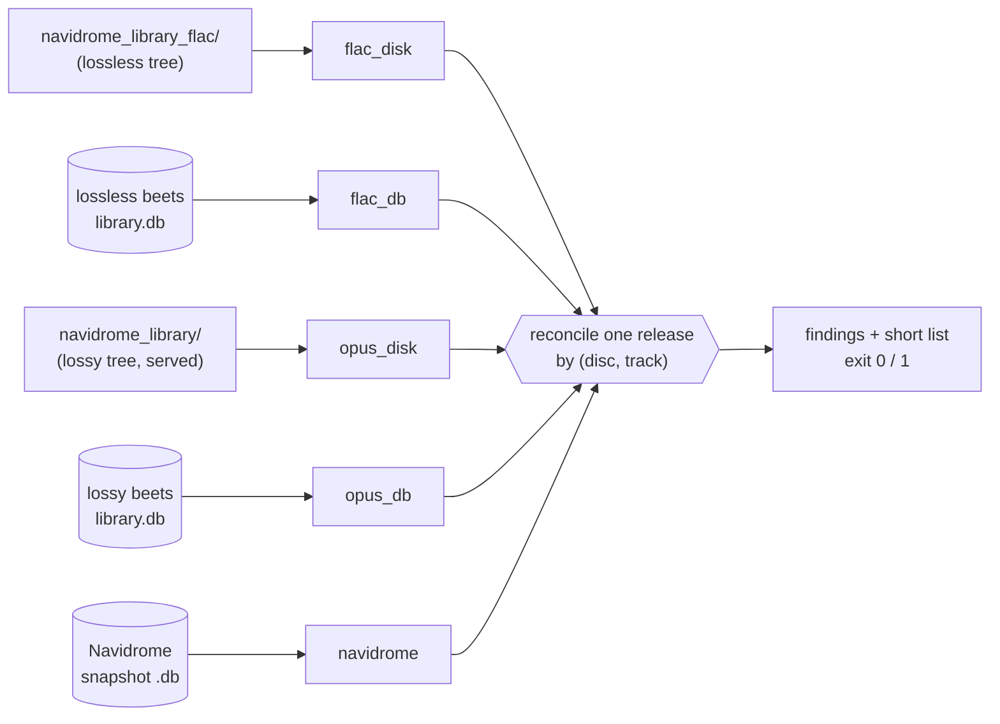

# `audit-library.py`

The library doctor. It reconciles the copies of the music library that exist on the server — two trees on disk, two beets databases, and the library Navidrome actually serves — and names the tracks that are missing or broken instead of leaving a silent partial import behind.

It has three modes:

| Mode | What it does |
|---|---|
| *(default)* | Whole-library audit: the pre-existing checks (path drift between the trees, tag differences, stale mtimes, album set differences). Unchanged. |
| `--release "Artist/Album"` | Release doctor: one release across the five views, with the short track list and a findings list. |
| `--missing` | Inventory of the files Navidrome has marked missing, with a mass-missing alarm. |

Everything is read-only. The doctor never creates, moves or deletes a file in either library, in either beets database, or in the Navidrome snapshot it reads.



## The five views

| View | Source | Key in the report |
|---|---|---|
| `flac_disk` | `navidrome_library_flac/Artist/Album[/Disc NN]/*.flac` | the files actually on disk |
| `flac_db` | lossless beets `library.db` → `items.path` | the rows beets believes exist |
| `opus_disk` | `navidrome_library/Artist/Album[/Disc NN]/*.opus` | the files Navidrome serves |
| `opus_db` | lossy beets `library.db` → `items.path` | the rows that should match `opus_disk` |
| `navidrome` | the snapshot passed with `--navidrome-db` | `media_file` rows of the matching `album` |

Only `opus_disk`/`opus_db` are compared against the Navidrome view, because that tree is the one Navidrome serves. A track counts as present in the Navidrome view when the snapshot has a `media_file` row for it.

## Release identity

A release is `Artist/Album` as stored on disk. Both trees are resolved separately, so the folder may differ between them in case only — the paths are NFC-normalised and compared case-insensitively.

* **Disc folders belong to the release.** `Disc 01`, `Disc 02`, … are collapsed into one release. A multi-disc release is never reported as several incomplete ones.
* **In beets** the release is the album whose items live in that folder, plus — when it is found there — the album id and every `mb_albumid` in play. `mb_albumid` is the identity that survives the two trees naming their folders differently; in the lossy database it is what links rows whose paths are broken.
* **In Navidrome** the release is every `album` row whose folder is that release folder, plus every album carrying one of the `mb_albumid` values above.
* **Track key** is `(disc, track)`. The disc comes from the `Disc NN` folder when there is one, otherwise from the database row. The title is only a tie-breaker, never the identity — two files with the same `(disc, track)` are reported as unreadable rather than guessed at.
* Track numbers are the album-wide numbers beets writes (`$disc_and_track`), so `02.10.` in `Disc 02` is track 10 of disc 2.

## Usage

```bash
# release doctor: one release across the five views
python3 audit-library.py \
    --lossless /mnt/musicbucket/navidrome_library_flac \
    --lossy    /mnt/musicbucket/navidrome_library \
    --release "William Basinski/William Basinski - [2026] Passing the Cup of Sorrows" \
    --navidrome-db /mnt/musicbucket/.ops/navidrome.db \
    --library-map /media/music=/mnt/musicbucket/navidrome_library

# same, machine-readable (read by the removal flow)
python3 audit-library.py --lossless … --lossy … --release "…" \
    --navidrome-db … --library-map … --json

# missing inventory (what the purge gate reads)
python3 audit-library.py --missing --missing-json missing.json --json

# whole-library audit, unchanged
python3 audit-library.py --lossless … --lossy …
```

| Flag | Meaning |
|---|---|
| `--lossless DIR` | root of the lossless tree. Required for the default audit and for `--release`. |
| `--lossy DIR` | root of the lossy tree (the one Navidrome serves). Required for the default audit and for `--release`. |
| `--release "Artist/Album"` | restrict the run to one release and print the five views. |
| `--navidrome-db FILE` | Navidrome snapshot to read. Never the live database. |
| `--library-map ROOT=DIR` | map a Navidrome `library.path` to a real directory. Repeatable; one mapping is required per library root in the snapshot. |
| `--missing` | read the Navidrome missing inventory from `--missing-json` instead of reconciling a release. |
| `--missing-json FILE` | file holding the output of `navidrome missing list -f json`. |
| `--mass-missing-threshold N` | number of missing rows that raises `MASS_MISSING` (default 20). |
| `--json` | one JSON document on stdout. Works with `--release` and with `--missing`. |
| `--list` | with `--release`, list every track of every view instead of the first `--samples`. |
| `--samples N` | entries shown per finding (default 10). |
| `--threads N` | parallel directory scans for the whole-library audit (default 16). |
| `--old DIR` | older copy of a lossy library to compare against `--lossy` (default audit only). |
| `--emit-missing-lossy FILE` | write the FLAC albums that have no Opus copy to FILE (default audit only). |

The default audit also accepts `--old` and `--emit-missing-lossy`; it prints the same report as before, byte for byte, when none of the new flags are given.

## Where to run it

Two places, same script, different paths. Both need Python 3.8+ (standard library only, `sqlite3` included) — the PVE host has 3.13, LXC 101 has the checkout.

### LXC 101 (beets container, has the checkout)

The volume is mounted at `/mnt/musicbucket` and the checkout lives at `/opt/alpargatify`:

```bash
ssh root@10.1.1.101
python3 /opt/alpargatify/library-organizer/audit-library.py \
    --lossless /mnt/musicbucket/navidrome_library_flac \
    --lossy    /mnt/musicbucket/navidrome_library \
    --release "Artist/Artist - [2024] Album"
```

### PVE host (`root@10.1.1.10`)

Same volume under `/mnt/usb-hdd-wd-5tb/musicbucket`, no checkout — copy the script there (it is a single file) and pass host paths. This is the location to use when the Navidrome snapshot has just been pulled with `pct pull`, because `sqlite3` is available on the host and not inside LXC 111:

```bash
scp library-organizer/audit-library.py root@10.1.1.10:/root/tools/
ssh root@10.1.1.10
python3 /root/tools/audit-library.py \
    --lossless /mnt/usb-hdd-wd-5tb/musicbucket/navidrome_library_flac \
    --lossy    /mnt/usb-hdd-wd-5tb/musicbucket/navidrome_library \
    --release "Artist/Artist - [2024] Album" \
    --navidrome-db /mnt/usb-hdd-wd-5tb/musicbucket/.ops/navidrome.db \
    --library-map /media/music=/mnt/usb-hdd-wd-5tb/musicbucket/navidrome_library
```

Do not trust an SMB mount from macOS for filenames: APFS hands them out as NFD and accented artist folders will look like mismatches. Run it on the host or in the container.

### Taking the snapshot

There is no `sqlite3` inside LXC 111, so the snapshot is made by Navidrome itself and pulled out:

```bash
pct exec 111 -- /usr/bin/navidrome -c /etc/navidrome/navidrome.toml backup create -d /var/lib/navidrome/backup
pct pull 111 /var/lib/navidrome/backup/navidrome_backup_<stamp>.db /mnt/usb-hdd-wd-5tb/musicbucket/.ops/navidrome.db
```

`server/navidrome-snapshot.sh` wraps both steps. The doctor opens the file read-only (`mode=ro&immutable=1`), so neither the snapshot nor a `-journal`/`-wal` companion is created or modified, and the snapshot can be reused by several runs. It reads `media_file`, `album`, `folder` and `library` only; artwork blobs are never touched.

The snapshot needs a `--library-map` for every `library.path` it holds — in this deployment that is `/media/music`. Without a mapping the run stops with the usage status instead of reporting the whole library as missing. `media_file.path` is relative to that root in current Navidrome; absolute paths from older snapshots are handled too.

### Missing inventory

```bash
pct exec 111 -- /usr/bin/navidrome -c /etc/navidrome/navidrome.toml missing list -f json > .ops/missing.json
python3 audit-library.py --missing --missing-json .ops/missing.json --json
```

The CLI prints an ASCII banner before its payload; the parser anchors on the first `[` and parses from there, so the banner does not break it. `MASS_MISSING` is raised when the number of missing rows exceeds `--mass-missing-threshold`.

## Reading the report

```text
release: William Basinski/William Basinski - [2026] Passing the Cup of Sorrows
identity: folder William Basinski/…; mb_albumid 6557ab83-5340-473a-8686-74d5a280de99

== views
  flac_disk   10 track(s)  /mnt/usb-hdd-wd-5tb/musicbucket/navidrome_library_flac
  flac_db     10 track(s)  /mnt/usb-hdd-wd-5tb/musicbucket/navidrome_library_flac  album 5506
  opus_disk    3 track(s)  /mnt/usb-hdd-wd-5tb/musicbucket/navidrome_library
  opus_db     10 track(s)  /mnt/usb-hdd-wd-5tb/musicbucket/navidrome_library  album 4713
  navidrome    3 track(s)  snapshot 2026-11-04 01:45  album 1fMG9UOOzKovxoUxqPgYI3

== tracks
  01.01  [ok]  William Basinski - Passing the Cup of Sorrow  flac_disk flac_db opus_disk opus_db navidrome
  01.04  [!!]  William Basinski - Passing the Cup of Sorrow  flac_disk flac_db opus_db

== findings
  [ERROR]  TRACK_SHORT  opus_disk  01.04  …  missing from opus_disk, navidrome
  [ERROR]  ORPHAN_PATH  opus_db  01.03  album 4713  …  at /import/Disc 01/01.03. ….opus

15 finding(s): 15 error, 0 warning; 7 short track(s) of 10; exit 1
```

The `== tracks` block is the reconciliation: a track is `[ok]` when it is in all five views, `[!!]` otherwise, and the trailing columns say where it was found. The `== findings` block repeats the same problems one per line, with the code, the responsible view, the track and the album id.

With `--json`, stdout carries exactly one document — the human report goes to stderr — shaped like this:

```json
{
  "tool": "audit-library.py", "generated": "2026-11-04 01:55", "read_only": true,
  "release": "Artist/Album",
  "identity": {"folder": "…", "mb_albumid": "…", "beets_albums": [5506, 4713],
               "navidrome_albums": ["1fMG9UOOzKovxoUxqPgYI3"]},
  "views": {"flac_disk": {"available": true, "count": 10, "tracks": ["01.01", "…"]}, "…": {}},
  "counts": {"flac_disk": 10, "flac_db": 10, "opus_disk": 3, "opus_db": 10, "navidrome": 3},
  "tracks": [{"disc": 1, "track": 1, "label": "01.01", "title": "…", "views": ["flac_disk", "…"], "short": false}],
  "short": ["01.04", "…"],
  "findings": [{"code": "TRACK_SHORT", "severity": "error", "view": "opus_disk", "disc": 1, "track": 4, "…": "…"}],
  "ok": false, "exit_status": 1
}
```

`--missing --json` emits the same shape with `count`, the missing `files` and the findings of the inventory.

## Finding codes

| Code | Severity | View | Meaning |
|---|---|---|---|
| `TRACK_SHORT` | error | the first view that has the track | A track is present somewhere but not in every view. The detail names the views that lack it. |
| `ORPHAN_PATH` | error | `opus_db` / `flac_db` | A database row points outside the library (absolute path), i.e. at the import staging area. Unusable for playback and for any later move. |
| `DB_NO_FILE` | error | `opus_db` / `flac_db` | A row names a library-relative path and the file is not there. |
| `FILE_NO_DB` | error | `opus_disk` / `flac_disk` | A file on disk has no row in its own database (the tree and its database disagree). |
| `NAV_ABSENT` | error | `opus_disk` | The release, or a track of it, is served on disk but Navidrome does not know it. |
| `NAV_GHOST` | error | `navidrome` | Navidrome knows tracks that exist in none of the libraries. When it is the whole album, the finding says the album is a purge candidate. |
| `NAV_SPLIT` | error | `navidrome` | One release is several Navidrome albums. The finding names each album id. |
| `NAV_MISSING_ROW` | warning | `navidrome` | The snapshot marks rows of this release as `missing`. Informational; it does not fail the run unless it exceeds the threshold. |
| `MASS_MISSING` | error | `navidrome` | The number of missing rows exceeds `--mass-missing-threshold`. |
| `UNREADABLE` | error | `flac_disk` / `opus_disk` | A file in the release folder cannot be read, or two files claim the same `(disc, track)`. |

## Exit statuses

| Status | Meaning |
|---|---|
| `0` | clean: nothing to report |
| `1` | findings: at least one error-severity finding (with or without `--json`) |
| `2` | usage: bad arguments, missing mapping, unreadable or non-Navidrome database, I/O error |
| `3` | unknown release: `--release` matched no album in any view (no per-view detail is printed) |

Warnings alone exit `0`.
