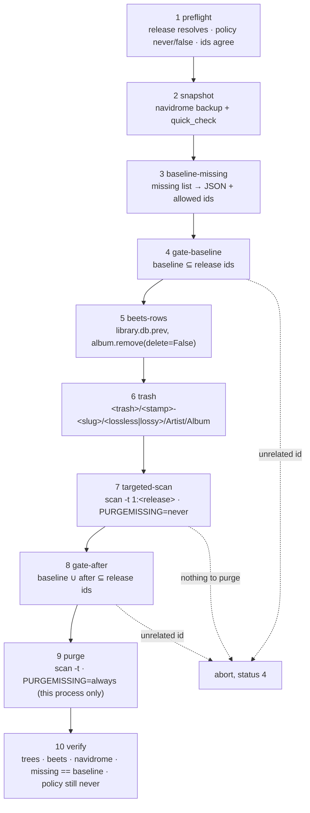

# `remove-album.sh` — guarded decommission of one release

Removes **one** release from every store of the stack, in the order fixed by design D11
(beets rows first, files second, Navidrome last), taking a verified Navidrome snapshot
before anything changes and refusing every step whose precondition is not met.

Two rules shape the whole script:

* the **file move** is the only destructive step that is cheap to undo — a `mv` from
  `.trash` back into the library;
* the **Navidrome purge is library-wide** (`DeleteAllMissing()`), so it runs only behind
  a gate that proves no row outside this release would be deleted.



## Requirements

| Requirement | Why | Check |
|---|---|---|
| `pct` (runs on the PVE host as root) | the beets and Navidrome containers are only reachable that way | `pct list` |
| `python3` on the host | JSON parsing of the inventories, gate arithmetic | `python3 -V` |
| `sqlite3` on the host | snapshot verification | `sqlite3 -version` |
| LXC 101 with `local/beets:latest` and `/mnt/musicbucket` mounted | the beets databases live next to the trees | `pct exec 101 -- docker images local/beets` |
| LXC 111 running Navidrome 0.64.2 | snapshot, scan, missing list, restore | `pct exec 111 -- systemctl is-active navidrome` |
| `MUSICBUCKET` exported to the **host** path | `common.sh` defaults to the container view | `echo "$MUSICBUCKET"` → `/mnt/usb-hdd-wd-5tb/musicbucket` |

`common.sh` defaults `MUSICBUCKET=/mnt/musicbucket`, which is what the *container* sees.
On the host that path does not exist, so every run must export the host path first;
`remove-album.sh` refuses with a hint instead of failing halfway through.

Invariants in `/etc/navidrome/navidrome.toml` that this tooling never touches and
asserts on every run: `[Scanner] PurgeMissing = "never"` and `ScanOnStartup = false`.
The purge sets `ND_SCANNER_PURGEMISSING=always` **for one process only** — the
persistent policy stays `never`.

## Usage

```bash
export MUSICBUCKET=/mnt/usb-hdd-wd-5tb/musicbucket

# 1. always look first: prints both album ids, both item counts, both moves, the
#    exact scan command, and leaves every store byte-identical
./library-organizer/server/remove-album.sh \
  --release "Artist/Artist - [2026] Album" --dry-run

# 2. the real run (asks you to type the release name unless --yes)
./library-organizer/server/remove-album.sh \
  --release "Artist/Artist - [2026] Album"

# a release Navidrome has never indexed: nothing to purge, so nothing to bound
./library-organizer/server/remove-album.sh \
  --release "Artist/Artist - [2026] Album" --purge none

# just the verdict of the gate on a set of inventories
./library-organizer/server/remove-album.sh gate \
  --allowed-json /tmp/allowed.json --baseline /tmp/before.json --after /tmp/after.json
```

| Flag | Meaning |
|---|---|
| `--release "Artist/Album"` | folder relative to both library roots (the same in both trees) |
| `--lossless-root DIR` | default `$MUSICBUCKET/navidrome_library_flac` |
| `--lossy-root DIR` | default `$MUSICBUCKET/navidrome_library` (the tree Navidrome serves) |
| `--purge auto\|api\|none` | `auto`: one targeted scan with `PURGEMISSING=always` after a passing gate (default); `api`: `DELETE /api/missing?id=<id>` per row, needs `ND_API_URL`/`ND_API_USER`/`ND_API_PASSWORD`; `none`: leave the rows to Navidrome |
| `--dry-run` | print every intended action, change nothing |
| `--yes` / `-y` | skip the typed confirmation |
| `--keep-trash` | on abort, keep the files in trash even while the move is still the only change |
| `--beets-tools-dir DIR` | folder inside LXC 101 holding `rm_album.py` (default `/opt/alpargatify/library-organizer/beets`) |
| `--keep N` | snapshots to keep (default 2) |
| `--json` | print exactly one JSON document (progress goes to stderr) |

Exit status (design D12): `0` removed and verified, `1` findings or leftovers,
`2` usage error, `3` unknown release (in no store), `4` aborted by a guard.

## What each stage leaves behind

| Stage | Writes | Undo |
|---|---|---|
| 2 snapshot | `$MUSICBUCKET/.ops/navidrome-<UTC>.db` | delete it, prune keeps two |
| 5 beets-rows | `library.db` per tree, previous as `library.db.prev` | copy `library.db.prev` back |
| 6 trash | `.trash/<stamp>-<slug>/<lossless\|lossy>/Artist/Album`, plus the `Artist` directory when it ends up empty | `mv` back |
| 9 purge | Navidrome `media_file` rows | `navidrome backup restore` |

Stage 5 turns off only the *rows*: `album.remove(delete=False)` never touches a file, so
between stages 5 and 6 the files are still in place and the database no longer knows
them — that window is why stage 6 comes immediately after.

## Trash: retention and manual pruning

```
/mnt/usb-hdd-wd-5tb/musicbucket/.trash/20261104T011211Z-zz-test-worker-b-zz-test-worker-b-2026-removal-probe/
├── lossless/zz-test-worker-b/zz-test-worker-b - [2026] Removal Probe/…
└── lossy/zz-test-worker-b/zz-test-worker-b - [2026] Removal Probe/…
```

* The path carries a UTC stamp (`YYYYMMDDTHHMMSSZ`, sortable) and a slug of the release,
  so two runs never share a directory; a name that already exists aborts the stage
  instead of overwriting a previous copy.
* After the move the `Artist` directory is removed **if it is now empty** (`rmdir`, which
  refuses anything else), so a one-album artist leaves no husk behind. An artist with
  other albums keeps its directory, as it should.
* Navidrome still holds a `folder` row for the removed album path (and for the artist
  path), flagged `missing=1`. It carries no media row, does not appear in
  `missing list`, and no targeted scan removes it — only a full-library scan would, which
  this tooling never runs. It is bookkeeping, not a playback or disk problem.
* One directory per **tree**: both trees hold the *same* relative path
  (`Artist/Album/…`), so the Artist/Album levels alone would collide on the second move.
* Nothing prunes `.trash` automatically. After a release has stayed removed and played
  correctly for a while:

```bash
# what is in there, biggest first
du -sh /mnt/usb-hdd-wd-5tb/musicbucket/.trash/* | sort -h

# delete one run (the whole release, both trees)
rm -rf "/mnt/usb-hdd-wd-5tb/musicbucket/.trash/20261104T011211Z-zz-test-worker-b-…-removal-probe"

# or every run older than 30 days
find /mnt/usb-hdd-wd-5tb/musicbucket/.trash -mindepth 1 -maxdepth 1 -type d \
  -mtime +30 -print -exec rm -rf {} +
```

The trash lives on the same filesystem as both libraries, so the move is a `rename` —
instant for any album size, no extra space used.

Runs whose name starts with `zz-` are **test artifacts** from the verification of this
tool on 2026-11-04 (`zz-test-worker-b…`, `zz-test-worker-b-probe…`, `zz-guard-probe…`,
`zz-emptydir-probe…`); they hold nothing but copies of two Basinski tracks. They are left
in place on purpose and pruned like any other run:

```bash
# the test runs specifically
find /mnt/usb-hdd-wd-5tb/musicbucket/.trash -mindepth 1 -maxdepth 1 -type d \
  -name '*zz-*' -print

# then remove them one by one, e.g.
rm -rf "/mnt/usb-hdd-wd-5tb/musicbucket/.trash/<name printed above>"
```

## Rollback, store by store

Every abort prints the exact commands for the stages that already changed something
(`restore=` lines in `--json`, `WARN:` blocks otherwise). The general shape:

**Files** — move the folder back out of trash. The script does this itself while no row
has been touched yet (a guard abort at stage 4/8/9 with `--purge` refused); once rows are
gone it only prints the commands, because moving files back would then contradict the
databases.

```bash
mv "/mnt/usb-hdd-wd-5tb/musicbucket/.trash/<run>/lossless/Artist/Album" \
   "/mnt/usb-hdd-wd-5tb/musicbucket/navidrome_library_flac/Artist/"
mv "/mnt/usb-hdd-wd-5tb/musicbucket/.trash/<run>/lossy/Artist/Album" \
   "/mnt/usb-hdd-wd-5tb/musicbucket/navidrome_library/Artist/"

# Navidrome then has to notice the files again
pct exec 111 -- /usr/bin/navidrome -c /etc/navidrome/navidrome.toml \
  scan -t 1:"Artist/Album"
```

Move with `mv` and never `cp`: a copy leaves the owner wrong (host `0:0` for a new file)
and the trees are owned by the container's uid.

**beets rows** — every tree keeps the previous database as `library.db.prev`, written by
`cp -p library.db library.db.prev.tmp && mv -f … .prev` *before* the rows are removed:

```bash
# nothing else writes these files: the beets container is one-shot, so just make sure
# no import or sync run is in flight
pct exec 101 -- sh -c 'cd /mnt/musicbucket/navidrome_library_flac && \
  cp -p library.db library.db.prev.restore && cp -p library.db.prev library.db'

# and the same for the lossy tree
pct exec 101 -- sh -c 'cd /mnt/musicbucket/navidrome_library && \
  cp -p library.db library.db.prev.restore && cp -p library.db.prev library.db'
```

**Navidrome rows** — restore the snapshot taken in stage 2, offline. `backup restore -b`
runs inside LXC 111 and resolves a **relative** name against `Backup.Path`
(`/var/lib/navidrome/backup`), so the file has to be visible *there* first:

```bash
# snapshots pulled by stage 2 (host side)
ls -l /mnt/usb-hdd-wd-5tb/musicbucket/.ops/navidrome-*.db

pct exec 111 -- systemctl stop navidrome
pct push 111 /mnt/usb-hdd-wd-5tb/musicbucket/.ops/navidrome-<UTC>.db \
  /var/lib/navidrome/backup/navidrome_backup_<UTC>.db
pct exec 111 -- /usr/bin/navidrome -c /etc/navidrome/navidrome.toml \
  backup restore -f -b navidrome_backup_<UTC>.db
pct exec 111 -- systemctl start navidrome
```

`backup restore` refuses while the service is running (that is what `-f` is for; keep
`navidrome` stopped until it returns). Afterwards the persistent policy must still read
`never`:

```bash
pct exec 111 -- grep -E '^\s*(PurgeMissing|ScanOnStartup)' /etc/navidrome/navidrome.toml
```

**The last resort, one row at a time** — `DELETE /api/missing?id=<media_file id>` removes
a single missing row without any scan. This is the escape hatch for the case where the
scan is wrong (a release you want back shows as missing, or one row survives a purge).
Get the row ids from the JSON inventory, log in for a token, and delete by id:

```bash
B=https://music.example.com
TOKEN=$(curl -sS -X POST "$B/auth/login" -H 'Content-Type: application/json' \
  -d "{\"username\":\"$ND_API_USER\",\"password\":\"$ND_API_PASSWORD\"}" | \
  python3 -c 'import json,sys; print(json.load(sys.stdin)["token"])')

# what is missing right now (the banner line before the array is normal)
pct exec 111 -- /usr/bin/navidrome -c /etc/navidrome/navidrome.toml missing list -f json

# drop exactly one row
curl -sS -X DELETE "$B/api/missing?id=<media_file id>" \
  -H "X-Nd-Authorization: Bearer $TOKEN"
```

`--purge api` does the same thing in bulk, refusing any id that was already missing before
the run started.

## Snapshots (`navidrome-snapshot.sh`)

Stage 2 shells out to this script; it is also usable on its own:

```bash
./library-organizer/server/navidrome-snapshot.sh          # create, verify, keep two
./library-organizer/server/navidrome-snapshot.sh --keep 5
./library-organizer/server/navidrome-snapshot.sh --no-prune
./library-organizer/server/navidrome-snapshot.sh --no-ct-copy
```

It runs `pct exec 111 -- navidrome backup create`, pulls the file into
`$MUSICBUCKET/.ops/navidrome-<UTC>.db`, switches the copy out of WAL mode so it stands
alone (no `-shm`/`-wal` sidecars), then verifies it with `pragma quick_check` plus a
`media_file`/`album`/`library` count and prints them as `snapshot=`/`media_file=`/
`albums=`/`libraries=`/`result=ok`. A snapshot that does not verify is deleted and the
stage aborts before anything is touched.

Retention: **two snapshots on each side**.

* host side: the script sorts `$MUSICBUCKET/.ops/navidrome-*.db` by name (the name is a
  sortable UTC stamp) and deletes everything past the newest `--keep`. It prunes the whole
  directory, so snapshots written by *another* host run count too — two is two across
  hosts, not two per host.
* container side: `navidrome backup prune -d /var/lib/navidrome/backup -k N -f` keeps the
  same number next to the live database.

Each snapshot is ~845 MB (885,112,832 bytes for 46.6k tracks). The container copy lives on
the LXC rootfs, which is inside the nightly `vzdump`, so keeping it doubles the snapshot
cost of the container backup; `--no-ct-copy` pulls and verifies, then deletes the
container-side file, at the price of one `pct push` before a `backup restore`.

## Troubleshooting

| Symptom | Cause | Fix |
|---|---|---|
| `MUSICBUCKET is still the container view …` | `MUSICBUCKET=/mnt/musicbucket` (the default) | `export MUSICBUCKET=/mnt/usb-hdd-wd-5tb/musicbucket` |
| `No beets database at '/mnt/musicbucket/…/library.db' inside LXC 101` | `--lossless-root`/`--lossy-root` points at something that is not a library | pass the real roots |
| `rm_album.py is not deployed to …` | the container tools directory is empty | `pct push 101 library-organizer/beets/rm_album.py /opt/alpargatify/library-organizer/beets/rm_album.py` |
| `Release '…' is in no store` (status 3) | the path is wrong or the release is already gone everywhere | check the spelling, `--dry-run` lists what exists |
| `ambiguous-path` / `unexpected-album-id` (status 4) | two albums share the folder, or the database has another id than expected | run `--dry-run`, compare `lossless_album_id`/`lossy_album_id` |
| `WARNING album … has N item(s) whose path is outside …` | rows with absolute `/import/…` paths migrated from the old Docker setup; they belong to the album | expected on the lossy database, they are removed with it |
| `Refusing to purge: the expected set is empty` (status 4) | Navidrome holds no row for this release, so a purge could only be library-wide | `--purge none` |
| `gate: the after set holds an unrelated entry` (status 4) | a scan marked something outside this release | re-read `missing list`, fix by hand, run again |

The audit side (`audit-library.py`, `docs/audit.md`) reads the same stores without
changing anything; use it to confirm the result afterwards.
